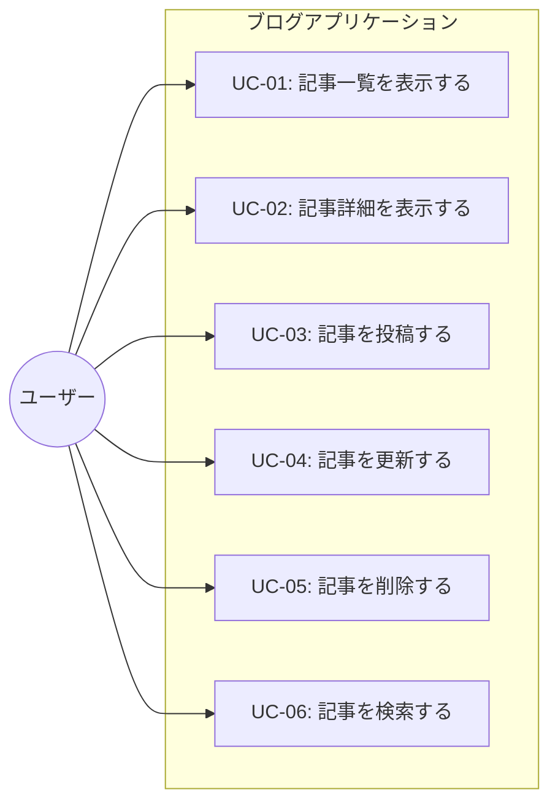

# ユースケース図・イベントフロー

## 1. ユースケース図

## 2. イベントフロー

### UC-01: 記事一覧表示
- **対応機能要件**: FR-01
- **アクター**: ユーザー
- **概要**: 投稿済みの記事の一覧を表示する。
- **事前条件**: アプリケーションが起動していること。
- **事後条件**: 投稿済みの記事一覧（タイトル、投稿日時）が新しい投稿順に表示されていること。
- **基本フロー**:
  1. ユーザーはブログアプリケーションにアクセスする。
  2. システムは保存されている記事の一覧を取得する。
  3. システムは記事のタイトルと投稿日時を新しい投稿順に並べて表示する。
- **代替フロー**:
  - **記事が存在しない場合**:
    1. システムは保存されている記事が存在しないことを確認する。
    2. システムは「記事がありません」と画面に表示する。

### UC-02: 記事詳細表示
- **対応機能要件**: FR-02
- **アクター**: ユーザー
- **概要**: 一覧から選択した記事の詳細情報（タイトル、本文、投稿日時）を表示する。
- **事前条件**: 記事一覧が表示されていること。
- **事後条件**: 選択した記事のタイトル、本文、投稿日時が表示されていること。
- **基本フロー**:
  1. ユーザーは記事一覧から閲覧したい記事を選択する。
  2. システムは選択された記事の情報（タイトル、本文、投稿日時）を取得する。
  3. システムは記事のタイトル、本文、投稿日時を画面に表示する。

### UC-03: 記事投稿
- **対応機能要件**: FR-03
- **アクター**: ユーザー
- **概要**: タイトルと本文を入力して、新しい記事を保存する。
- **事前条件**: 記事投稿画面が表示されていること。
- **事後条件**: 新しい記事が保存され、一覧等に反映されていること。
- **基本フロー**:
  1. ユーザーは記事のタイトルと本文を入力し、投稿ボタンを押下する。
  2. システムは入力されたタイトルおよび本文のバリデーションを行う。
  3. システムは自動で一意な記事IDを付与し、現在日時を投稿日時として記録して記事を保存する。
  4. システムは保存完了画面または更新された記事一覧画面を表示する。
- **代替フロー / 例外フロー**:
  - **入力エラーの場合**:
    1. 1でユーザーがタイトルまたは本文を空欄または空白のみで送信しようとした場合、システムはエラーメッセージを表示する。
    2. 記事は保存されず、ユーザーは再入力を求められる。

### UC-04: 記事更新
- **対応機能要件**: FR-04
- **アクター**: ユーザー
- **概要**: 投稿済みの記事のタイトルと本文を変更して保存する。
- **事前条件**: 対象記事の編集画面が表示されていること。
- **事後条件**: 変更後のタイトルと本文が保存されていること（投稿日時は変更されない）。
- **基本フロー**:
  1. ユーザーは記事のタイトルおよび/または本文を変更し、更新ボタンを押下する。
  2. システムは入力されたタイトルおよび本文のバリデーションを行う。
  3. システムは記事のタイトルと本文を更新し、保存する（投稿日時は変更しない）。
  4. システムは更新完了画面または更新後の記事詳細画面を表示する。
- **代替フロー / 例外フロー**:
  - **入力エラーの場合**:
    1. 1でユーザーがタイトルまたは本文を空欄または空白のみに変更して送信しようとした場合、システムはエラーメッセージを表示する。
    2. 記事は更新されず、ユーザーは再入力を求められる。

### UC-05: 記事削除
- **対応機能要件**: FR-05
- **アクター**: ユーザー
- **概要**: 選択した記事を確認後に削除する。
- **事前条件**: 削除対象の記事（詳細画面等）が表示されていること。
- **事後条件**: 選択した記事が削除され、一覧や検索結果に表示されなくなること。
- **基本フロー**:
  1. ユーザーは削除ボタンを押下する。
  2. システムは削除確認ダイアログを表示する。
  3. ユーザーは削除を承認（「OK」など選択）する。
  4. システムは対象の記事を削除する。
  5. システムは記事一覧画面を表示する。
- **代替フロー / 例外フロー**:
  - **削除確認でキャンセルした場合**:
    1. 3でユーザーが削除確認ダイアログで「キャンセル」を選択した場合、システムは削除処理を中断する。
    2. 記事は削除されず、元の画面状態を維持する。

### UC-06: 記事検索
- **対応機能要件**: FR-06
- **アクター**: ユーザー
- **概要**: 入力したキーワードが含まれる記事（タイトルまたは本文）を一覧表示する。
- **事前条件**: 検索機能が存在する画面（一覧画面等）が表示されていること。
- **事後条件**: 条件に一致した記事の一覧が表示されていること。
- **基本フロー**:
  1. ユーザーは検索フォームにキーワードを入力し、検索ボタンを押下する。
  2. システムはタイトルまたは本文にキーワードが含まれる記事を検索する。
  3. システムは該当する記事を一覧表示する。
- **代替フロー**:
  - **検索キーワードが空欄の場合**:
    1. 1でユーザーが検索キーワードを空欄のまま検索を実行した場合、システムはすべての記事を一覧表示する。
  - **該当する記事が0件の場合**:
    1. 2の検索結果が0件であった場合、システムは「該当する記事がありません」と表示する。
